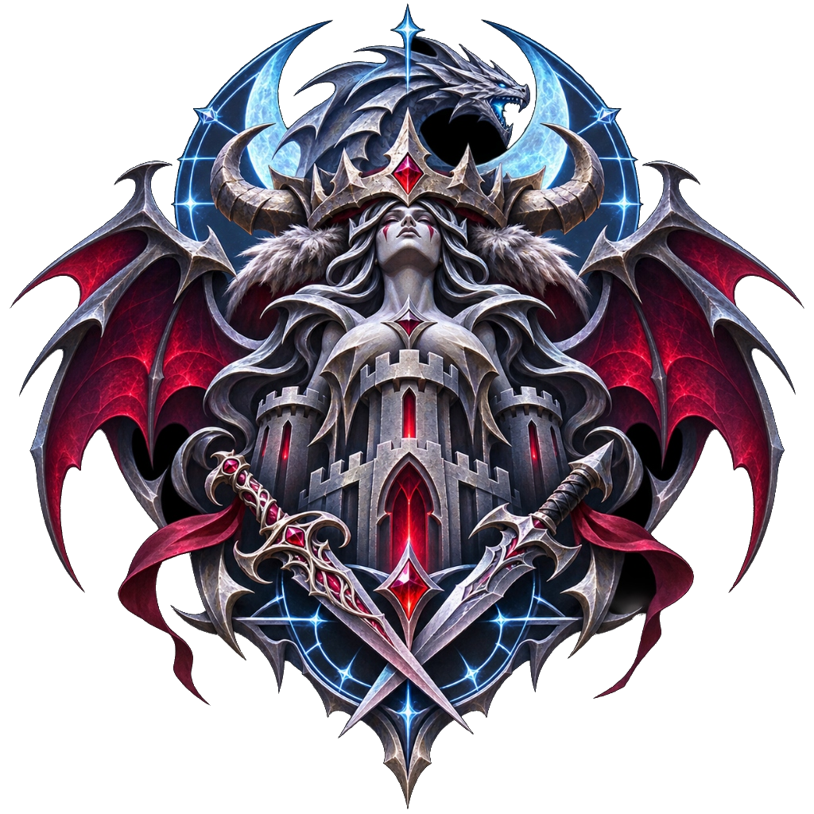
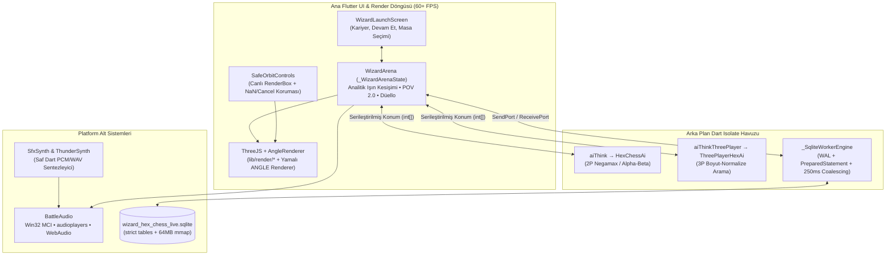
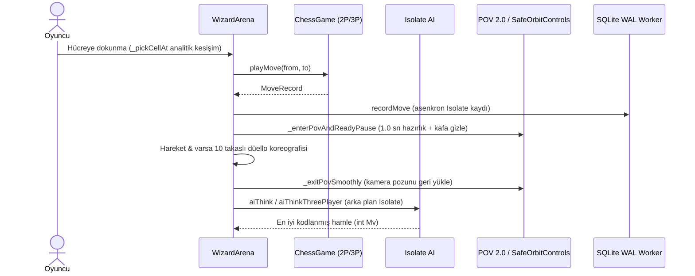
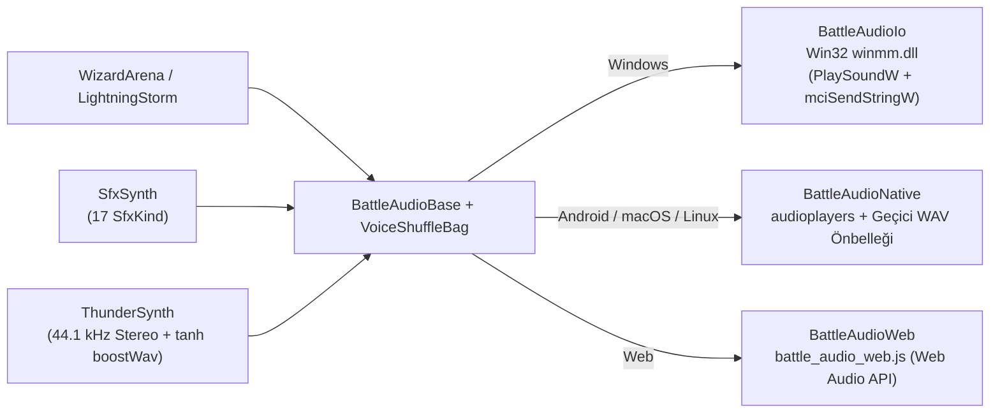

<div align="center">



# PROJECT.md — Wizard Hex Chess 3D Teknik Mimari Belgesi

**Saf Dart + Flutter + WebGL/ANGLE Tabanlı 3B Altıgen Amfi Satrancının Mühendislik ve Sistem Tasarımı**

[← Vitrin Sayfasına Dön (README.md)](README.md) • [Güvenlik Politikası (SECURITY.md)](SECURITY.md) • [Lisans (LICENSE.md)](LICENSE.md) • [Renderer Yamaları (PATCHES.md)](third_party/three_js_angle_renderer/PATCHES.md) • [Ses Rehberi (ELEVENLABS_REHBERI.md)](voices/ELEVENLABS_REHBERI.md)

</div>

---

## 📑 İçindekiler

1. [Proje Vizyonu ve Temel Prensipler](#1-proje-vizyonu-ve-temel-prensipler)
2. [Yüksek Seviyeli Sistem Mimarisi](#2-yüksek-seviyeli-sistem-mimarisi)
3. [Altıgen Tahta Geometrisi ve Kural Motorları (2P & 3P)](#3-altıgen-tahta-geometrisi-ve-kural-motorları-2p--3p)
4. [24 Kademeli Arka Plan Yapay Zekâ Motoru](#4-24-kademeli-arka-plan-yapay-zekâ-motoru)
5. [Prosedürel 3B Heykeltıraşlık, PBR ve Savaş Koreografisi](#5-prosedürel-3b-heykeltıraşlık-pbr-ve-savaş-koreografisi)
6. [GPU Fırtına Girdabı ve Fiziksel Yıldırım Sistemi](#6-gpu-fırtına-girdabı-ve-fiziksel-yıldırım-sistemi)
7. [Çapraz Platform 3B Render Yamaları ve Kamera Güvenliği](#7-çapraz-platform-3b-render-yamaları-ve-kamera-güvenliği)
8. [Çok Platformlu Ses ve Sentez Mimarisi](#8-çok-platformlu-ses-ve-sentez-mimarisi)
9. [SQLite WAL Kalıcılık Motoru ve Veri Güvenliği](#9-sqlite-wal-kalıcılık-motoru-ve-veri-güvenliği)
10. [Otomatik Test Matrisi ve Doğrulama](#10-otomatik-test-matrisi-ve-doğrulama)

---

## 1. Proje Vizyonu ve Temel Prensipler

`Wizard Hex Chess 3D`, harici bir oyun motoru (`Unity`, `Godot`, `Unreal`) veya uzaktan çalışan oyun/yapay zekâ sunucusu olmadan, tek bir **Flutter / Dart** kod tabanında (~22.200 satır `lib/` Dart kodu) şu bileşenleri birleştirir:

- **Sıfır Harici 3B Varlık Bağımlılığı:** Tüm satranç sütunları, gotik hisar kuleleri ve 6 eklemli yaratık sınıfı çalışma anında prosedürel olarak örülür.
- **Sıfır Kare Donduran Çoklu Isolate Mimarisi:** Yapay zekâ araması (`compute`) ve SQLite WAL veritabanı I/O'su (`Isolate.spawn`) ana UI/render iş parçacığından tamamen ayrıdır.
- **Sınırsız Atmosfer & Düello Özelleştirmesi:** Kaydırıcı aralıklarının ötesine geçen doğrudan sayısal giriş desteği ve yüksek ses seviyelerinde `tanh` yumuşak kırpma.
- **%100 Çevrimdışı ve Gizlilik Dostu:** Üretim derlemelerinde ağ telemetrisi, analiz aracı veya tehlikeli Android izni yoktur.

---

## 2. Yüksek Seviyeli Sistem Mimarisi



### Hamle & Kare Yaşam Döngüsü (`POV 2.0` + `Düello` + `SQLite`)



---

## 3. Altıgen Tahta Geometrisi ve Kural Motorları (2P & 3P)

### 3.1 Eksenel Koordinat Sistemi & Amfi Yükseltisi
[`HexBoard`](lib/game/hex_board.dart) ve [`BoardShape`](lib/game/hex_board.dart), Gliński altıgen ızgarasını eksenel `(q, r)` koordinatları ve türetilmiş üçüncü küp ekseni `s = -q - r` ile tanımlar:

- **Dünya XZ İzdüşümü (`HexBoard.worldXZ`):**
  - `x = 1.5 * tileRadius * q`
  - `z = -sqrt(3) * tileRadius * (r + q / 2)` (`tileRadius = 0.86`)
- **Amfi Basamak Yüksekliği (`BoardShape._wingElevation`):** Ordular arka cephede `1.33–1.46` birime kadar yükselen basamaklı sütunlar üzerinde durur (Barbar Kral `1.46`, Vampir Kraliçe `1.42`); savaş meydanının ortası `0.18` tabanına iner. Yürüyen ve dövüşen savaşçıların ayakları [`surfaceHeightAtWorld`](lib/game/hex_board.dart) ile sütun basamaklarına yumuşak şekilde oturur.
- **Tahta Ölçekleme (`playScale`):** Geniş (`127`), Büyük (`169`) ve Dev (`217`) 3 kişilik masalarda oyun katmanı (`_playLayer`) `BoardShape.extent` oranı ile Klasik arenanın kapladığı alana sığdırılır; böylece fırtına girdabı, kule halkası ve kamera kadrajı bozulmaz.

### 3.2 Dolgulu (Padded) Dizi Motorları & Tek Tam Sayı Hamle Kodlaması
Her iki kural motoru da sınır kontrollerini dallanmasız ve sıfır tahsisli (*zero-allocation*) kılmak için tahtayı çevreleyen **3 hücrelik güvenlik dolgusu (`Position.off = 99`)** kullanır:

- **2 Kişilik Motor ([`Position`](lib/game/chess_game.dart)):** `17 × 17 = 289` hücreli düz tam sayı dizisi (`q, r ∈ [-8, 8]`). 91 geçerli hücre, çift adım piyon açılışı, *en passant*, şah/açmaz kontrolü, Vampir Kraliçe (veya seçilen sınıf) terfisi, 50 hamle ve 3 kez konum tekrarı kurallarını uygular.
- **3 Kişilik Motor ([`ThreePlayerPosition`](lib/game/three_player_game.dart) & [`Hex3Geometry`](lib/game/three_player_game.dart)):** Seçilen [`BoardSize`](lib/game/hex_board.dart) (`radius ∈ {5, 6, 7, 8}`) değerine göre `span = 2 * radius + 7` boyutlu dinamik dolgulu dizi oluşturur. Ordular 120° dönme simetrisiyle (`rot120`) kendi köşelerine yerleştirilir. Bir ordu mat olduğunda tahtadan ışık sütunlarıyla çözünerek çıkar ve kalan iki ordu savaşı sürdürür.
- **Kompakt Hamle Kodlaması (`Mv`):** Tek `int` içinde paketlenir:
  - Bit `0..8`: `from` indeksi (9 bit — Dev tahta `23×23` dahil `≤ 448` aralığına sığar)
  - Bit `9..17`: `to` indeksi
  - Bit `18`: `doublePush` · Bit `19`: `enPassant` · Bit `20`: `promotion`
  - Bit `21..23`: terfi taş kodu (`2..5`)

### 3.3 Analitik Işın Seçimi (`_pickCellAt`)
Standart üçgen ağı raycasting'i yerine [`_pickCellAt`](lib/main.dart), kameradan çıkan ışını her hücrenin **üst altıgen tablası**, **yan sütun silindiri** (`colRad = 0.80`) ve üzerinde savaşçı varsa **yaratık silindiri** (`rigRad = 0.40`, `y ∈ [topY, topY + 1.10]`) ile analitik olarak kesiştirir; böylece perspektif açısı ne olursa olsun seçimler piksel hassasiyetinde ve mikro-saniyeler içinde çözülür.

---

## 4. 24 Kademeli Arka Plan Yapay Zekâ Motoru

[`AiLevel`](lib/game/ai.dart) 4 ana ligde **24 kademeli** ELO merdiveni sunar:

| Lig | Kademe Aralığı | ELO Aralığı | 2P Derinlik / Süre | 3P Derinlik / Süre | Davranış Profili |
| :--- | :--- | :---: | :---: | :---: | :--- |
| **Kolay • Çırak** | `lvl1` – `lvl6` | `600 – 1100` | `1–2` / `70–160 ms` | `1–2` / `100–220 ms` | `%12–%45` gaf olasılığı ve rastgele gürültü (`noise: 50–180`) |
| **Orta • Savaşçı** | `lvl7` – `lvl12` | `1200 – 1700` | `2–3` / `180–400 ms` | `2–3` / `250–490 ms` | Düşen gaf (`%0–%7`), merkez ve taş gelişimi |
| **Zor • Büyücü** | `lvl13` – `lvl18` | `1800 – 2300` | `4–5` / `460–920 ms` | `3–4` / `560–1050 ms` | `%0` gaf, tam sükûnet araması (*quiescence*) |
| **Efsanevi • Başbüyücü** | `lvl19` – `lvl24` | `2400 – 2900` | `5–7` / `1060–2300 ms` | `4–5` / `1200–2700 ms` | Derin iteratif Alfa-Beta, son oyun ve üç tekrar kaçınması |

### Arama Motoru Özellikleri
- **2P ([`HexChessAi`](lib/game/ai.dart)):** İteratif derinleşen Negamax + Alfa-Beta budaması, taş alma zincirleri için sükûnet araması (*quiescence*), MVV-LVA taş değeri sıralaması (`Piyon=100, At=305, Fil=340, Kale=510, Vezir=950`), derinlik başına `killer` hamleler ve `history` sezgisel puanlaması; ön-hesaplı merkez ve piyon terfi mesafesi tabloları.
- **3P ([`ThreePlayerHexAi`](lib/game/three_player_ai.dart)):** Tahta boyutuna (`Klasik..Dev`) göre normalize edilen parça-kare tabloları (`_EvalTables`), üç kez tekrar beraberliği puanlaması (`repetitionHashes`) ve Dev tahta için `1.2x` süre çarpanı (`thinkTimeScale3P`).

---

## 5. Prosedürel 3B Heykeltıraşlık, PBR ve Savaş Koreografisi

### 5.1 `Sculptor` & Tek Mesh Çoklu Yüzey PBR (`MatSurface`)
[`sculptor.dart`](lib/render/sculptor.dart), klasik düşük poligon küp/küre birleştirmesi yerine Catmull-Rom / kesit interpolasyonuyla organik gövde, kıvrımlı pelerin ve dövme zırh yüzeyleri örer:
- **8×1 ORM `DataTexture`:** Tek bir `MeshStandardMaterial` içinde vertex UV'sinin X ekseni `MatSurface.uvX` değerine haritalanarak aynı geometrinin farklı parçalarına birbirinden bağımsız pürüzlülük (*roughness*) ve metaliklik (*metalness*) atanır:
  `skin (0)` · `cloth (1)` · `leather (2)` · `scale (3)` · `stone (4)` · `horn (5)` · `armor (6)` · `bladeGold (7)`
- **Performans Kazancı:** Her savaşçının draw-call sayısı minimumda tutulurken deri, çelik zırh, altın işleme ve kumaş arasındaki ışık tepkileri fiziksel olarak ayrışır.

### 5.2 Eklemli Yaratık İskeletleri & POV 2.0
[`CreatureRig`](lib/render/creatures.dart) her taş için eklemli parça hiyerarşisi (`head`, `torso`, `armL`, `armR`, `legL`, `legR`, `wingL`, `wingR`, `cape`, `tail`, `orb`) ve dinlenme pozisyonu önbelleği (`rest`) saklar:
- **POV 2.0 Senkronizasyonu:** [`setFirstPersonMode(true)`](lib/render/creatures.dart) yalnızca kameranın içine girebilecek kafa/saç parçalarını gizler; gövde, kollar, silahlar ve bacaklar görünür kalır. Kamera `near = 0.035 * _playScale` yakın kırpma düzlemiyle silah detaylarını kesmeden çizer ve adım/darbe sırasında hafif kamera yatışı (`_povRoll`) uygular.

### 5.3 Çift Hızlı Animatör & 10 Takaslı Düello Sistemi
- **[`Animator`](lib/render/battle_fx.dart):** Hareket (`AnimKind.move`), savaş (`AnimKind.combat`) ve sinematik/kamera (`AnimKind.fixed`) zaman çizelgelerini ayrı hız çarpanlarıyla yönetir.
- **10 Düello Takas Türü (`_DuelExchange`):** `press`, `counter`, `bind`, `dodge`, `combo`, `feint`, `circle`, `bash`, `knockdown`, `leap`. Düello turu (`duelRounds`) ve karmaşıklık (`duelComplexity`) kadar süren çarpışmaların ardından infaz türü (`DeathMode`: `topple`, `slash`, `burn`, `crush`, `drain`, `launch`) tetiklenir; kullanıcı dokunuşu `_duelSkip` ile doğrudan son darbeye atlar.

---

## 6. GPU Fırtına Girdabı ve Fiziksel Yıldırım Sistemi

### 6.1 `StormVortex` Shader Katmanları
[`storm_vortex.dart`](lib/render/storm_vortex.dart) tüm bulut hareketini CPU yerine GLSL shader içinde hesaplar (dönüş fazları `dt` ile biriktirildiği için hız değiştikçe desen zıplamaz):
- **Katman Hiyerarşisi:** `kStormAbyss` (dip disk) → `kStormSea` (log-polar fbm bulut denizi) → `kStormOuterWall` & `kStormInnerWall` (tırmanan göz duvarı konileri) → `kStormEdgeMist` (platform kenar sisi) → `kStormBelt1..4` (gotik kuleler arasından geçen bulut kuşakları) → rüzgâr şeritleri, ışık izleri, savrulan bulutlar ve yağmur sağanağı.
- **Tahta Koruması (`stBoardClear`):** Kameradan dünya noktasına giden ışın, oyun tahtasını temsil eden iki yatay koruma diskiyle (`uClear`) kesişirse tahtanın önündeki parçacık/duvar katmanları yumuşakça şeffaflaşır.
- **Doğrusal Renk Uzayı Sisi:** Sis yoğunluğu (`stormFog`) arttıkça arka plan rengi ve sis kararmaz; `_toLinear` / `_toSrgb` dönüşümüyle ışığı saçan açık gri-mavi bir pusa (`kStormHazeColor`) geçilir.

### 6.2 `LightningStorm` 3 Aşamalı Yıldırım Fiziği
[`lightning_storm.dart`](lib/render/lightning_storm.dart) gerçekçi buluttan kuleye yıldırım modelini uygular:
1. **Öncü Kanal (~70 ms):** Sönük plazma yolu bulut içinden kule ucuna doğru iner.
2. **Dönüş Darbeleri:** Kanal 2–4 kez titreyerek yüksek parlaklıkta çakar, kıvılcım ve gökyüzü parlaması oluşturur.
3. **Kalıcı Kanal (`linger`):** Yan dallar önce söner, ana kanal mora kayarak yumuşakça sönerken sahneyi aşırı beyazlatmadan aydınlatmaya devam eder (`_skyLight` yumuşak sönüm).

---

## 7. Çapraz Platform 3B Render Yamaları ve Kamera Güvenliği

### 7.1 `third_party/three_js_angle_renderer` Yamaları
`pubspec.yaml` üzerinden `dependency_overrides` ile bağlanan yerel kopyadaki 5 kritik düzeltme ([`PATCHES.md`](third_party/three_js_angle_renderer/PATCHES.md)):

1. **Her Karede Shader Programı Aranması (`renderer.dart` / `angle_programs.dart`):** `toneMapping = toneMapping;` kendi kendine atama hatası `toneMapping = this.toneMapping;` olarak düzeltildi; ACES ton eşlemesiyle derlenen malzemelerin her karede yeniden `getProgram()` aramasına düşmesi engellendi.
2. **Windows Yırtılmasız Birleştirme (`Settings.tearFreeComposite`):** Paylaşımlı D3D dokusunda yarım çizilmiş karelerin (bulut/yağmur katmanlarının kaybolması) ekrana gelmesini önlemek için sahne önce `isXRRenderTarget` ekran dışı hedefe çizilip tek tam ekran üçgenle kopyalanır.
3. **Yeniden Boyutlandırmada Köşe Bozulması (`_ensureCompositeTarget`):** `RenderTarget.dispose()` yalnızca ilk çağrıda çalıştığı için boyut değişiminde hedef `setSize` yerine baştan kurulur ve `angle.resize()` sırasında yarım kare çizilmez.
4. **Android İlk Kare `(0, 0)` Doku Hatası (`initSize`):** Android soğuk açılışında geçici `(0, 0)` `MediaQuery` boyutu geldiğinde `createTexture` çağrısı ertelenerek `PlatformException(no texture width)` engellenir.
5. **Android Dokunup Döndürmede Tek Renk Ekranı (`ThreeJS.build`):** İlk `(0, 0)` karede `core.Peripherals` ağaca bağlandığında `clientHeight` kalıcı olarak `0.0` kilitleniyordu; artık pozitif `screenSize` ve `_initStarted` oluşana kadar `Peripherals` kurulmaz.

### 7.2 `SafeOrbitControls`
[`safe_orbit_controls.dart`](lib/render/safe_orbit_controls.dart), harici `three_js_controls` paketindeki `OrbitControls`'u genişleterek dört ek güvence sağlar:
- `PeripheralsState._clientHeight` önbelleği yerine her harekette canlı `RenderBox.size` (yedek: `_engine.screenSize`) okur; yön değişimi veya boyut sıfırlığında bölme hatasını engeller.
- İki parmak çimdiklemede (`handleTouchMoveDolly`) `dollyStart.y <= 1e-3` ve `distance <= 1e-3` durumlarında sıfıra bölmeyi önler.
- `onPointerCancel` olayında `state = OrbitState.none` sıfırlaması ve dinamik `pointermove`/`pointerup` dinleyicilerinin temizlenmesini garanti eder (eksik temizlikten doğan `RangeError` ve 2x/3x dönüş hızlanmasını önler).
- `update()` öncesi/sonrası kamera konumu, hedefi ve quaternion'unun sonlu (`isFinite`) kalmasını zorunlu kılar.

---

## 8. Çok Platformlu Ses ve Sentez Mimarisi



- **Paketli Ses Varlıkları (`assets/audio/`):** 6 yaratık sınıfı × 6 varyasyon (`36` `.mp3` + `36` `.wav`) ve [`dark_fantasy_soundtrack.wav`](assets/audio/dark_fantasy_soundtrack.wav) (toplam 73 dosya).
- **Anti-Tekrar Kura Torbası ([`VoiceShuffleBag`](lib/audio/battle_audio_base.dart)):** Bir karakterin 6 repliği de oynatılmadan aynı replik gelmez; torba yenilenirken son çalınan repliğin hemen ilk sıraya düşmesi önlenir.
- **Yumuşak Ses Yükseltici (`ThunderSynth.boostWav`):** %100 üzeri kullanıcı ses ayarlarında WAV örneklerini `tanh` eğrisiyle doyurarak cızırtı/dijital kırpma olmadan ses şiddetini artırır.

---

## 9. SQLite WAL Kalıcılık Motoru ve Veri Güvenliği

[`GameDatabase`](lib/data/game_database_io.dart) (`lib/data/game_database.dart` üzerinden Web'de [`game_database_stub.dart`](lib/data/game_database_stub.dart) yedeğine düşer) ayrı bir arka plan `Isolate` (`WizardHexSqliteWorker`) içinde çalışır:

### Veritabanı Pragmaları & Şema (`user_version = 2`, `STRICT`)
- `PRAGMA journal_mode = WAL;` · `PRAGMA synchronous = NORMAL;` · `PRAGMA busy_timeout = 5000;` · `PRAGMA temp_store = MEMORY;` · `PRAGMA cache_size = -8000;` · `PRAGMA mmap_size = 67108864;`
- **Tablolar:**
  1. `app_settings (key PRIMARY KEY, value, updated_at)` — 250 ms birleştirilmiş (coalesced) ayar kaydı
  2. `player_profile (id=1, commander_name, elo_2p, elo_3p, games_played, wins, losses, draws, total_captures, play_seconds, updated_at)` — Canlı komutan profili
  3. `matches (id, variant, board_size, mode, ai_level, human_team, status, winner_team, ply_count, encoded_moves_json, started_at, updated_at)` — En fazla 200 tamamlanmış maç arşivi
  4. `match_moves (id, match_id REFERENCES matches ON DELETE CASCADE, ply, team, piece, from_cell, to_cell, captured_piece, promoted, encoded_move, created_at)` — Adım adım hamle geçmişi ve geri-al desteği

### Gizlilik ve İzin Duruşu
- Üretim Android manifestinde (`android/app/src/main/AndroidManifest.xml`) `INTERNET` veya hassas cihaz izni yoktur.
- Tüm veriler yalnızca uygulamanın kendi özel destek dizinindeki (`getApplicationSupportDirectory()`) `wizard_hex_chess_live.sqlite` dosyasında ve geçici ses önbelleğinde tutulur.

---

## 10. Otomatik Test Matrisi ve Doğrulama

Tüm doğrulama paketi `flutter analyze` (0 uyarı/hata) ve `flutter test` ile **70 otomatik test** üzerinden geçirilir:

| Test Dosyası | Kapsam |
| :--- | :--- |
| [`test/hex_board_test.dart`](test/hex_board_test.dart) | 91 hücreli 2P Gliński kuralları, notasyon, *en passant*, terfi, açmaz, `makeMove`/`unmakeMove`, POV iskeletleri ve YZ mat testleri |
| [`test/three_player_board_size_test.dart`](test/three_player_board_size_test.dart) | 4 tahta boyutunun (`91/127/169/217`) bağımsız başvuru üreteciyle tam çapraz doğrulaması, 3P YZ arama ve SQLite `board_size` kalıcılığı |
| [`test/database_and_persistence_test.dart`](test/database_and_persistence_test.dart) | SQLite WAL şema göçü, 250 ms ayar birleştirme, hamle/geri-al kaydı, ELO güncelleme ve 200 maç arşiv budaması |
| [`test/atmosphere_test.dart`](test/atmosphere_test.dart) | `ThunderSynth.boostWav` yumuşak sınırlayıcı, üst sınırsız `AtmosphereSlider` widget testleri, `LightningStorm` kalıcılığı ve `StormVortex` sis matematiği |
| [`test/voice_shuffle_bag_test.dart`](test/voice_shuffle_bag_test.dart) | `VoiceShuffleBag` tekrar önleme, 36 replik kataloğu ve `assets/audio/` içindeki 36 MP3 + 36 WAV dosya doğrulaması |
| [`test/orbit_controls_android_test.dart`](test/orbit_controls_android_test.dart) | Android `(0, 0)` ilk kare `Peripherals` ertelemesi, `0×0` NaN koruması, ekran döndürmede canlı yükseklik ve iki parmak çimdikleme / `onPointerCancel` testleri |
| [`test/widget_test.dart`](test/widget_test.dart) | Açılış ekranında (`WizardLaunchScreen`) 2P/3P masa düzeni ve tahta boyutu seçimi widget testi |

### Doğrulama Komutları
```powershell
flutter analyze
flutter test
```

---

## 🔒 Lisans ve Güvenlik Başvuruları

- **Lisans:** [`LICENSE.md`](LICENSE.md) (`LicenseRef-TheDEvorger-UPSL-1.3` — TheDEvorger Universal Proprietary Software License v1.3; üçüncü taraf bileşenlerden [`third_party/three_js_angle_renderer`](third_party/three_js_angle_renderer/LICENSE) kendi MIT lisansına tabidir).
- **Güvenlik Politikası:** [`SECURITY.md`](SECURITY.md) (`thedevorger.alekrythae.dev@gmail.com`).
