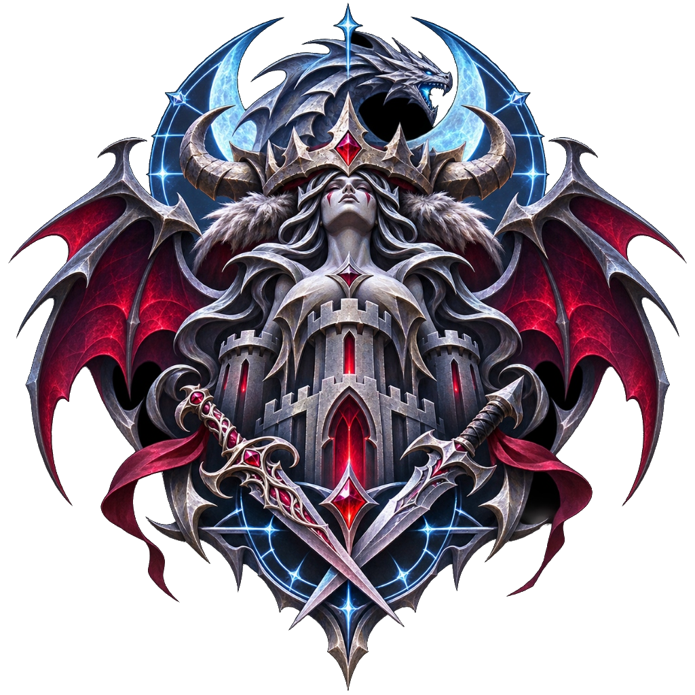
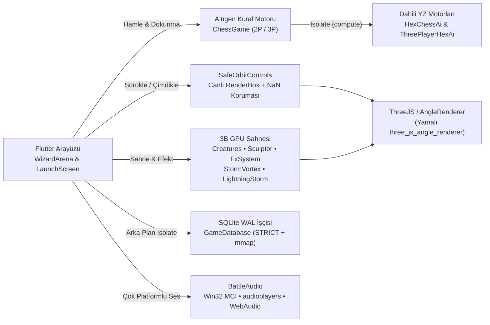

<div align="center">



# WIZARD HEX CHESS — DART 3D

**Gerçek Zamanlı 3D Karanlık-Fantezi Altıgen Amfi Satrancı, Prosedürel Yaratık Orduları ve Çok İş Parçacıklı Yapay Zekâ Motoru**

[](https://flutter.dev)
[](https://dart.dev)
[](third_party/three_js_angle_renderer/PATCHES.md)
[](lib/data/game_database_io.dart)
[](#kurulum-ve-%C3%A7al%C4%B1%C5%9Ft%C4%B1rma)
[](#test-ve-do%C4%9Frulama)

*Harici oyun motoru (Unity, Godot, Unreal) ve bulut sunucusu yok — 3B heykeltıraşlık, GPU fırtına shader'ları, gök gürültüsü/SFX sentezi, SQLite kalıcılığı ve 24 kademeli Alfa-Beta yapay zekâsı **%100 saf Dart + Flutter** içinde çalışır.*

[Öne Çıkanlar](#-öne-çıkan-özellikler) • [Ordular & Yaratıklar](#-yaratık-orduları-ve-üç-lejyon) • [Tahta & Modlar](#-tahta-düzenleri-ve-oyun-modları) • [POV & Düello](#-pov-20-ve-interaktif-düello-sistemi) • [Fırtına & Ses](#-gpu-fırtına-girdabı-ve-canlı-ses-motoru) • [Mimari](#-mimari-özet) • [Kurulum](#-kurulum-ve-çalıştırma) • **[PROJECT.md](PROJECT.md)** • **[SECURITY.md](SECURITY.md)** • **[LICENSE.md](LICENSE.md)**

</div>

---

## ✨ Öne Çıkan Özellikler

<table>
  <tr>
    <td width="50%" valign="top">
      <h3>♟️ Tam Gliński 2P & 3P Altıgen Satranç</h3>
      <ul>
        <li><strong>2 Kişilik Düello (91 hücre)</strong> ve <strong>3 Kişilik Amfi Masası</strong> (4 boyut: 91 / 127 / 169 / 217 hücre).</li>
        <li>Çift adım piyon açılışı, 3 yönlü taş hareketi, geçerken alma (<em>en passant</em>), açmaz, şah-mat, pat, 50 hamle ve 3 tekrar kuralları.</li>
        <li>3 kişilik modda bir ordunun şahı düştüğünde kalan orduların savaşı kesintisiz devam eder; düşen ordu sahnede ışık sütunlarıyla çözünür.</li>
      </ul>
    </td>
    <td width="50%" valign="top">
      <h3>🗿 Prosedürel 3B Heykeltıraşlık (PBR)</h3>
      <ul>
        <li>Dış <code>.glb/.obj</code> modeli olmadan <strong><code>Sculptor</code></strong> motoruyla eklemli 3B yaratıklar, zırh katmanları, pelerinler ve gotik hisar kuleleri inşa edilir.</li>
        <li>Tek mesh içinde <strong>8×1 ORM DataTexture</strong> ile 8 fiziksel yüzey kanalı (<code>skin</code>, <code>cloth</code>, <code>leather</code>, <code>scale</code>, <code>stone</code>, <code>horn</code>, <code>armor</code>, <code>bladeGold</code>).</li>
        <li>Üç ayrı ordu paleti: <strong>Gümüş Şafak</strong> (Beyaz), <strong>Kızıl Obsidyen</strong> (Siyah) ve <strong>Zümrüt Fırtına</strong> (Zümrüt).</li>
      </ul>
    </td>
  </tr>
  <tr>
    <td width="50%" valign="top">
      <h3>👁️ POV 2.0 Kamera & Çok Turlu Düellolar</h3>
      <ul>
        <li>İnsan ve YZ hamlelerinde kamera savaşçının göz hizasına iner, <strong>1 sn</strong> savaş narası ve silah/çizme selamıyla hamleye hazırlanır.</li>
        <li>10 farklı takas hareketiyle (<em>press, counter, bind, dodge, combo, feint, circle, bash, knockdown, leap</em>) çok turlu düello koreografisi; ekrana kısa dokunuşla son darbeye atlanabilir.</li>
        <li>Hareket hızı, dövüş hızı, düello tur sayısı ve karmaşıklık seviyesi canlı olarak ayarlanır (elle sınırsız giriş destekli).</li>
      </ul>
    </td>
    <td width="50%" valign="top">
      <h3>🧠 24 Kademeli Arka Plan Yapay Zekâsı</h3>
      <ul>
        <li><strong>600 ELO (Acemi Köylü)</strong> → <strong>2900 ELO (Antik Büyük Üstat)</strong> arasında 24 kademe.</li>
        <li>İteratif derinleşen Negamax + Alfa-Beta budaması, sükûnet araması (<em>quiescence</em>), MVV-LVA, <em>killer</em> ve <em>history</em> hamle sıralaması.</li>
        <li>Ayrı Dart <strong><code>Isolate</code></strong> üzerinde çalışır; 3B sahne ve animasyonlar 60+ FPS akıcılığını korur.</li>
      </ul>
    </td>
  </tr>
  <tr>
    <td width="50%" valign="top">
      <h3>⛈️ GPU Fırtına Girdabı & Fiziksel Yıldırım</h3>
      <ul>
        <li>Tamamen GLSL shader tabanlı <strong><code>StormVortex</code></strong>: log-polar spiral bulut denizi, göz duvarı, kule kuşakları, yağmur ve rüzgâr izleri.</li>
        <li><strong><code>stBoardClear</code></strong> koruması: tahtayı örten bulut/yağmur parçaları kameraya göre şeffaflaşır, oyun alanı her açıdan açık kalır.</li>
        <li>3 aşamalı <strong><code>LightningStorm</code></strong> (70 ms öncü kanal → dönüş darbeleri → kalıcı plazma kanalı) ve uzaklığa bağlı gök gürültüsü gecikmesi.</li>
      </ul>
    </td>
    <td width="50%" valign="top">
      <h3>🔊 Çapraz Platform Ses & 💾 SQLite WAL</h3>
      <ul>
        <li>Paketli <strong>36 karakter repliği</strong> (MP3 + WAV) + karanlık fantezi fon müziği + 17 tür prosedürel <strong><code>SfxSynth</code></strong> + 4 katmanlı stereo <strong><code>ThunderSynth</code></strong>.</li>
        <li>Peş peşe aynı repliğin gelmesini önleyen <strong><code>VoiceShuffleBag</code></strong> kura torbası ve isteğe bağlı harici <code>voices/</code> desteği.</li>
        <li>Arka plan <code>Isolate</code> üzerinde <strong>SQLite WAL</strong> (<code>STRICT</code> şema, 64 MB <code>mmap</code>, 250 ms ayar birleştirme, 200 maçlık arşiv, geri al/devam et ve canlı ELO).</li>
      </ul>
    </td>
  </tr>
</table>

---

## 🗺️ Tahta Düzenleri ve Oyun Modları

Amfi arenası yükseklik katmanlarına sahip altıgen sütunlardan oluşur; dış halka yüksek, merkez arena ise daha alçak basamaklıdır. Büyük 3 kişilik masalar sahne içinde otomatik ölçeklenerek (`playScale`) fırtına, kuleler ve kamera kadrajıyla kusursuz uyum sağlar.

| Varyant | Boyut | Yarıçap | Hücre Sayısı | Notasyon Sütunları | Başlangıç Dizilimi |
| :--- | :--- | :---: | :---: | :--- | :--- |
| **2 Kişilik Düello** | `Klasik` | `5` | **91** | `a..l` (`j` atlanır) | Beyaz (Güney) vs Siyah (Kuzey) — 18'er taş |
| **3 Kişilik Masa** | `Klasik` | `5` | **91** | `a..l` (`j` atlanır) | 3 köşe × 16 savaşçı (48 taş) |
| **3 Kişilik Masa** | `Geniş` | `6` | **127** | `a..n` (`j` atlanır) | 3 köşe × 16 savaşçı (48 taş) |
| **3 Kişilik Masa** | `Büyük` | `7` | **169** | `a..p` (`j` atlanır) | 3 köşe × 16 savaşçı (48 taş) |
| **3 Kişilik Masa** | `Dev` | `8` | **217** | `a..r` (`j` atlanır) | 3 köşe × 16 savaşçı (48 taş) |

### Oyun Modları
- **İnsan vs Yapay Zekâ** *(2P: İnsan vs YZ · 3P: İnsan vs 2 YZ)* — 24 kademeden seçilen zorluğa karşı ELO puanlı maçlar.
- **Aynı Cihazda Çoklu Oyuncu** *(2P: 2 Oyuncu · 3P: 3 Oyuncu)* — Sıra tabanlı yerel masa karşılaşması.
- **Canlı İzleme** *(2P: YZ vs YZ · 3P: 3 YZ Canlı Savaş)* — Yapay zekâ ordularının tam sinematik savaşını izleme.

---

## ⚔️ Yaratık Orduları ve Üç Lejyon

Klasik satranç taşları yerine her rol, eklemli `CreatureRig` iskeletine, özel silahlara, özgün infaz animasyonlarına (`topple`, `slash`, `burn`, `crush`, `drain`, `launch`) ve kendi ses sınıfına sahip bir fantastik savaşçıdır:

| Klasik Rol | Yaratık Sınıfı | Tasarım & Silahlar | Hareket & İnfaz Koreografisi |
| :--- | :--- | :--- | :--- |
| **Şah** | **Barbar Kral** | Boynuzlu kuzey tacı, kurt postu pelerin, çift ağızlı hilal balta ve savaş borusu | Ağır zırhlı yürüyüş; kasırga dönüşü ve hilal baltayla rakibi savurarak ezer |
| **Vezir** | **Vampir Kraliçe** | Kan yakutu taç, gotik kadife elbise, kanatlı asa, kan küresi ve yarasalar | Havada süzülüş; yarasa sürüsü salıp yaşam özünü emer (`drain`) |
| **Kale** | **Kadın Savaş Devi** | Kanatlı Valkür tacı, uzun örgülü saçlar, dikenli kol kalkanı ve dev savaş balyozu | Yeri sarsan ağır adımlar; dev balyoz darbesiyle rakibi yere çakar (`crush`) |
| **Fil** | **Ejderha** | Pullu gövde, karın zırh plakaları, açılır çene, boynuzlar ve dört parmaklı deri kanat | Kanat çırparak yüksekten süzülür; havadan büyülü ejder ateşi püskürtür (`burn`) |
| **At** | **Suikastçi** | Gölgeli kukuleta, deri maske, pelerin ve çift kıvrık Şam kukri hançeri | Gölgelere/dumana sıçrayıp rakibin arkasında belirir ve ikiz hançerle biçer (`slash`) |
| **Piyon** | **Kalkan Muhafızı** | Sallet şövalye miğferi, perçinli kule kalkan ve çelik teber | Düzenli piyade yürüyüşü; teber darbesiyle devirir; son hatta seçilen sınıfa terfi eder |

### Üç Lejyon Paleti
- ❄️ **Beyaz Ordu — Gümüş Şafak:** Fırçalanmış gümüş çelik, antik altın süsleme, gece safiri kumaş, buz mavisi büyü parıltısı.
- 🔥 **Siyah Ordu — Kızıl Obsidyen:** Koyu obsidyen zırh, kan kırmızısı pelerin ve yakut çekirdekli alevler.
- 🌿 **Zümrüt Ordu — Zümrüt Fırtına:** Zümrüt-yeşim zırh plakaları, yosun zümrüt kumaşlar ve parlak yeşim rün parıltısı *(3 kişilik masada aktif)*.

---

## 👁️ POV 2.0 ve İnteraktif Düello Sistemi

- **Karakter Gözünden Savaş (POV 2.0):** `POV Modu` açıkken hamle yapan savaşçının kafa/saç parçaları gizlenir (`setFirstPersonMode(true)`) ve kamera tam göz hizasına yerleşir; yürürken silahı, kolları ve bacakları 1:1 senkron görünür.
- **1 Saniyelik Savaş Komutu & Hazırlık:** Hareket başlamadan önce 1 saniyelik geri sayım halkası eşliğinde savaşçı savaş narasını atar ve sınıfına özel silah/çizme selamını verir.
- **Serbest Etrafına Bakma:** POV sürerken bile fare veya parmakla sürükleyerek savaşçının sağını, solunu ve silahlarını inceleyebilir (`Bakışı Sıfırla`) veya üst sağdaki **Tahtaya Dön** düğmesiyle hemen genel görünüme çıkabilirsiniz.
- **10 Türlü Çok Turlu Düellolar:** Taş alma anlarında savaşçılar yalnız tek darbe vurmaz; ayarlanan **Kapışma Turu** (`duelRounds`) ve **Düello Karmaşıklığı** (`duelComplexity`) doğrultusunda çarpışır (`press`, `counter`, `bind`, `dodge`, `combo`, `feint`, `circle`, `bash`, `knockdown`, `leap`). Düello sırasında ekrana kısa dokunarak kalan turları atlayıp **Son Darbe**ye geçebilirsiniz.

---

## 🧠 24 Kademeli Yapay Zekâ Motoru

| Kategori | Kademeler | ELO Aralığı | Arama Derinliği (2P / 3P) | Karakteristik |
| :--- | :---: | :---: | :---: | :--- |
| **Kolay • Çırak** | `lvl1` – `lvl6` | `600` – `1100` | `1–2` / `1–2` | Acemi gaf olasılığı (`%12–%45`) ve yüzeysel taktik |
| **Orta • Savaşçı** | `lvl7` – `lvl12` | `1200` – `1700` | `2–3` / `2–3` | Dengeli taş ve merkez hakimiyeti, düşük/sıfır gaf |
| **Zor • Büyücü** | `lvl13` – `lvl18` | `1800` – `2300` | `4–5` / `3–4` | Sıfır gaf, sükûnet araması + *killer/history* sezgiselleri |
| **Efsanevi • Başbüyücü** | `lvl19` – `lvl24` | `2400` – `2900` | `5–7` / `4–5` | Derin iteratif Alfa-Beta, son oyun ve üç tekrar kaçınması |

- **2 Kişilik Motor ([`ai.dart`](lib/game/ai.dart)):** İteratif derinleşen Negamax + Alfa-Beta budaması, *quiescence search*, MVV-LVA taş alma sıralaması, *killer* ve *history* tabloları.
- **3 Kişilik Motor ([`three_player_ai.dart`](lib/game/three_player_ai.dart)):** Normalize edilmiş boyut-bağımsız konum tabloları, dinamik düşünme süresi ölçekleme (`thinkTimeScale3P`) ve üç kez konum tekrarı beraberliğinden kaçınma.

---

## ⛈️ GPU Fırtına Girdabı ve Canlı Ses Motoru

### Fırtına & Atmosfer Stüdyosu
- **9 Katmanlı Shader Girdabı ([`storm_vortex.dart`](lib/render/storm_vortex.dart)):** `kStormAbyss`, `kStormSea`, `kStormOuterWall`, `kStormInnerWall`, `kStormEdgeMist` ve kulelerin arasından süzülen 4 kuşak (`kStormBelt1..4`) + parçacık katmanları (rüzgâr şeritleri, ışık izleri, savrulan bulutlar, yağmur sağanağı) + çöken yer sisi.
- **Fiziksel Yıldırım ([`lightning_storm.dart`](lib/render/lightning_storm.dart)):** Kule uçlarına (`_spireTips`) düşen çok kanallı yıldırımlar, gökyüzü/bulut parlamaları, kıvılcım saçılımı ve mesafeye göre gecikmeli yakın/uzak gök gürültüsü.
- **Üst Sınırsız Kaydırıcılar ([`atmosphere_slider.dart`](lib/ui/atmosphere_slider.dart)):** Kaydırıcı sınırlarının ötesine geçmek için her parametrede doğrudan sayısal giriş kutusu bulunur; sis yoğunluğu arttıkça görüntü kararmak yerine doğrusal ışık uzayında açık gri-mavi pusa dönüşür.

### Ses ve Sentez Sistemi
- **Paketli 73 Ses Dosyası (`assets/audio/`):** 6 karakter × 6 replik (36 `.mp3` + 36 `.wav`) + [`dark_fantasy_soundtrack.wav`](assets/audio/dark_fantasy_soundtrack.wav).
- **Tekrar Önleyici Kura Torbası (`VoiceShuffleBag`):** Bir karakterin 6 repliği de çalınmadan aynı replik tekrar gelmez; yeni torbaya geçerken önceki torbanın son repliğinin hemen peşine düşmesi engellenir.
- **Prosedürel Sentezleyiciler:** [`SfxSynth`](lib/audio/sfx_synth.dart) (17 tür zırh adımı, balta/hançer/balyoz darbesi, ejder ateşi, savaş narası yedekleri) ve [`ThunderSynth`](lib/audio/thunder_synth.dart) (44.1 kHz stereo WAV, `tanh` yumuşak sınırlayıcılı `boostWav` ile %100 üstü ses desteği).

---

## 🏛️ Mimari Özet



> Tüm alt sistemlerin sınıf düzeyindeki ayrıntıları, GLSL akışı, SQLite şeması, Android/Windows renderer yamaları ve doğrulama matrisi için **[`PROJECT.md`](PROJECT.md)** belgesine bakın.

---

## 🎮 Kontroller ve Kamera

| İşlem | Fare / Masaüstü | Dokunmatik (Android) | Klavye |
| :--- | :--- | :--- | :--- |
| **Taş Seçme / Hamle** | Sol tık | Kısa dokunuş | — |
| **Kamerayı Döndürme** | Sol tık + sürükle | Tek parmak sürükle | — |
| **Yakınlaştırma** | Fare tekerleği | İki parmak çimdikleme | — |
| **Tahtayı Kaydırma (Pan)** | Sağ/Orta tık sürükle veya `Tahtayı Taşı` modu | `Tahtayı Taşı` modu + sürükle veya iki parmak | `W A S D` / Ok Tuşları |
| **Kamera Açıları & Merkez** | Alt dock (`Kamera`, `Ortala`) | Alt dock (`Kamera`, `Ortala`) | — |
| **POV Bakış & Düello Atlama** | Sürükleyerek etrafa bak / kısa tıkla son darbeye atla | Parmakla etrafa bak / kısa dokunuşla son darbeye atla | — |

---

## 🚀 Kurulum ve Çalıştırma

### Gereksinimler
- **Flutter SDK** (`>= 3.44.0`) ve **Dart SDK** (`>= 3.6.0 < 4.0.0`)
- **Windows:** Visual Studio C++ masaüstü geliştirme araçları
- **Android:** Android SDK / NDK (Vulkan donanımlı API 28+ cihazlarda ANGLE, diğer cihaz/emülatörlerde otomatik OpenGL ES 3 geçişi)
- **Web:** Chrome veya Edge

### Komutlar

```powershell
# 1. Bağımlılıkları indir
flutter pub get

# 2. Statik analiz ve tüm testleri çalıştır (70 test)
flutter analyze
flutter test

# 3. Hedef platformda başlat
flutter run -d windows
flutter run -d android
flutter run -d chrome
```

> **Kare Süresi Profili (İsteğe bağlı):** CPU/çizim sürelerini ve shader arama sayılarını konsolda görmek için `--dart-define=WHC_FRAME_STATS=true` bayrağıyla çalıştırabilirsiniz.

---

## 📁 Proje Yapısı

```text
Alekrythae-WizardHexChess_Dart3D/
├── README.md                              # Vitrin ve hızlı başlangıç belgesi
├── PROJECT.md                             # Kapsamlı teknik mimari ve mühendislik belgesi
├── SECURITY.md                            # Güvenlik açığı bildirim ve depo hijyeni politikası
├── LICENSE.md                             # TheDEvorger Universal Proprietary Software License v1.3
├── pubspec.yaml                           # Bağımlılıklar ve three_js_angle_renderer override
├── assets/
│   ├── branding/game_logo.png             # Oyun arması
│   └── audio/                             # 36 MP3 + 36 WAV karakter sesi + dark_fantasy_soundtrack.wav
├── voices/
│   └── ELEVENLABS_REHBERI.md              # İsteğe bağlı harici 144 ses paketi rehberi
├── lib/
│   ├── main.dart                          # 3B arena, POV 2.0, düello koreografisi, HUD ve akış
│   ├── audio/
│   │   ├── battle_audio.dart              # Platform seçici arayüz (io / web / stub)
│   │   ├── battle_audio_base.dart         # VoiceShuffleBag, ses ayarları ve ortak sözleşme
│   │   ├── battle_audio_io.dart           # Windows Win32 MCI/PlaySound + yerel yönlendirme
│   │   ├── battle_audio_native.dart       # Android/macOS/Linux audioplayers arka ucu
│   │   ├── battle_audio_web.dart          # Tarayıcı Web Audio API arka ucu
│   │   ├── battle_audio_stub.dart         # Platform dışı güvenli yedek
│   │   ├── sfx_synth.dart                 # 17 tür prosedürel savaş & adım sentezleyici
│   │   ├── thunder_synth.dart             # 4 katmanlı stereo gök gürültüsü & tanh ses yükseltici
│   │   └── voice_catalog.dart             # 6 yaratık × 6 replik Türkçe savaş narası kataloğu
│   ├── data/
│   │   ├── game_database.dart             # Koşullu dışa aktarım (IO / Stub)
│   │   ├── game_database_io.dart          # Arka plan Isolate üzerinde SQLite WAL motoru
│   │   ├── game_database_stub.dart        # Web yedek kalıcılık katmanı
│   │   └── game_models.dart               # Ayarlar, ELO profili, maç özeti, kalite profilleri
│   ├── game/
│   │   ├── hex_board.dart                 # BoardVariant, BoardSize (91..217), eksenel koordinatlar
│   │   ├── chess_game.dart                # 2P tam Gliński kural motoru + hamle kodlama
│   │   ├── three_player_game.dart         # 3P 120° simetrik amfi motoru (Hex3Geometry)
│   │   ├── ai.dart                        # 24 kademeli Negamax/Alpha-Beta YZ (Isolate)
│   │   └── three_player_ai.dart           # 3 kişilik arka plan YZ motoru (Isolate)
│   ├── render/
│   │   ├── sculptor.dart                  # 3B eğri heykeltraşı + 8 yüzeyli ORM PBR dokusu
│   │   ├── creatures.dart                 # 6 yaratık sınıfı, 3 ordu paleti, POV iskeleti
│   │   ├── battle_fx.dart                 # Parçacık havuzları, şok dalgaları ve çift hızlı animatör
│   │   ├── storm_vortex.dart              # 9 katmanlı GLSL fırtına girdabı & yer sisi
│   │   ├── lightning_storm.dart           # 3 aşamalı fiziksel yıldırım & gök gürültüsü zamanlayıcı
│   │   └── safe_orbit_controls.dart       # Canlı RenderBox + sıfır/NaN/iptal korumalı OrbitControls
│   └── ui/
│       ├── launch_screen.dart             # Açılış lobisi, SQLite kariyer/devam et & masa seçimi
│       ├── creature_badge.dart            # Özel vektörel yaratık rozetleri
│       └── atmosphere_slider.dart         # Kaydırıcı + üst sınırsız sayısal giriş bileşeni
├── third_party/three_js_angle_renderer/   # 5 kritik düzeltmeli yerel three_js_angle_renderer (bkz. PATCHES.md)
├── tool/
│   └── generate_soundtrack.dart           # Prosedürel fon müziği WAV üretici aracı
└── test/                                  # 7 test paketinde toplam 70 otomatik test
```

---

## 🔒 Güvenlik Politikası ve Lisans

- **Güvenlik ([`SECURITY.md`](SECURITY.md)):** Uygulama tamamen çevrimdışı çalışır; Android üretim manifestinde `INTERNET`, konum, kamera, mikrofon veya depolama izni yoktur. Kayıtlar yalnızca uygulamanın kendi özel SQLite veritabanında (`wizard_hex_chess_live.sqlite`) tutulur. Güvenlik bildirimleri için: `thedevorger.alekrythae.dev@gmail.com`.
- **Lisans ([`LICENSE.md`](LICENSE.md)):** Bu proje **TheDEvorger Universal Proprietary Software License v1.3** (`LicenseRef-TheDEvorger-UPSL-1.3`, Copyright © 2026–present TheDEvorger. All Rights Reserved) kapsamındadır — kaynak kodun görüntülenebilir olması açık kaynak veya ticari kullanım izni vermez. Yerel yamalı `three_js_angle_renderer` bileşeni kendi MIT lisansına tabidir (bkz. [`third_party/three_js_angle_renderer/LICENSE`](third_party/three_js_angle_renderer/LICENSE)).
